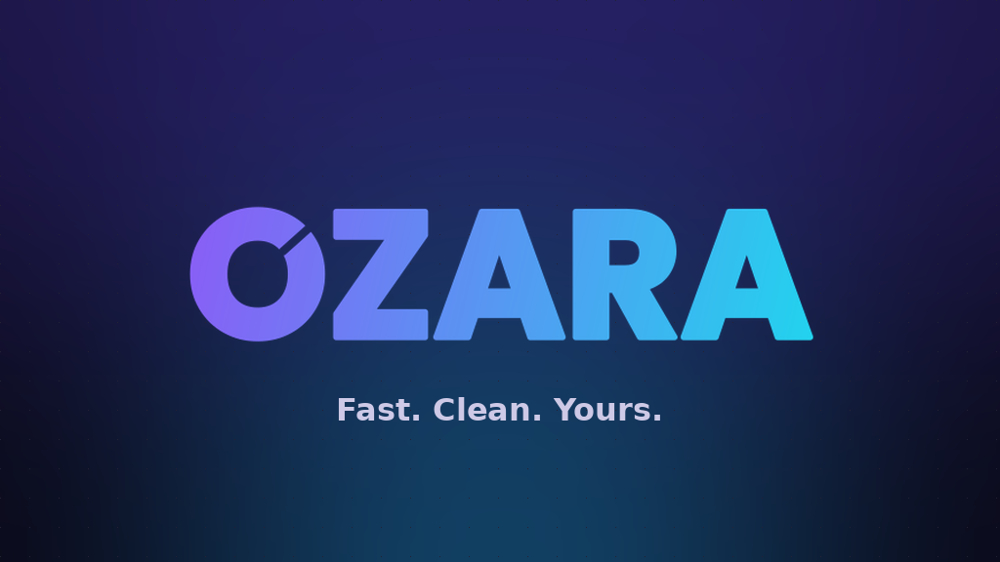

<p align="center">
  
</p>

<p align="center">
  <b>A free, fast Roblox launcher and companion app for Windows.</b><br>
  Find games, join friends, tune performance, and keep Roblox running smoothly, even on older PCs.
</p>

<p align="center">
  <a href="https://github.com/hojs2468-art/OzaraUpdater/releases/latest"></a>
  
  
  
  <a href="https://github.com/hojs2468-art/OzaraUpdater/releases"></a>
</p>

<p align="center">
  <a href="#-download">Download</a> ·
  <a href="#-features">Features</a> ·
  <a href="#-is-it-safe">Is it safe?</a> ·
  <a href="#-faq">FAQ</a> ·
  <a href="#-changelog">Changelog</a> ·
  <a href="#-building-from-source">Build from source</a>
</p>

---

## ✨ What is Ozara?

Ozara is a desktop app that sits **beside** Roblox, not inside it. It launches your games, finds servers, remembers your friends and favourites, and applies graphics and performance settings for you, all through files and links that Roblox already supports.

It's built for two kinds of players:

- **People on low-end or older PCs** who want Roblox to run smoother: lower texture resolution, FPS caps, lighter graphics presets and a CPU priority boost.
- **People who play a lot** and want a faster way around: a front page of popular games, one-click server picking, joining friends, update alerts and Discord status.

> **Ozara is not a cheat, an executor or an injector.** It never touches Roblox's memory or code. See [Is it safe?](#-is-it-safe)

---

## 📥 Download

1. Go to the **[latest release](https://github.com/hojs2468-art/OzaraUpdater/releases/latest)**.
2. Download **`ozara.exe`**.
3. Run it. Ozara renames itself to `OzaraLauncher.exe` on first launch and keeps itself up to date from then on.

**Requirements:** Windows 10 or 11 (64-bit) and Roblox installed. Discord is optional (for Rich Presence).

> Windows SmartScreen may warn about a new, unsigned app. Click **More info → Run anyway**. This is normal for small independent apps without a paid code-signing certificate.

---

## 🚀 Features

### 🔎 Discover: a front page for games
- **Featured games** shown as large banner cards, sorted by how many people are playing right now.
- **Trending** row plus genre rows: Obbies, Simulators, Tycoons, Horror, Roleplay, Shooters, Anime, Racing, Fighting, Survival, Tower Defense and more.
- **Infinite scroll**: keep scrolling and new rows keep loading.
- **Play** jumps straight into a game; clicking a card opens its details page.
- **↺ Rejoin last** puts you back in the last game you played.

### 👥 Friends
- **Bulk import** your whole friends list in seconds, through your own signed-in browser. Ozara never asks for your password or login cookie.
- **Add friends by username**, with their avatar shown.
- **Join** any friend's game with one click, using Roblox's official "follow user" link.
- **Friends on Home**: your friends sit in a strip on the Home page, with display name and @username. Click one to open their profile card, right-click to join their game straight away.
- Works even when Roblox hides your account's friends list from apps: import it once and it stays saved.

### 🪪 Profile cards
- Click any player (friends, search results) to open a **Roblox-style profile card**.
- A large **full-body picture of their avatar** in their current outfit.
- **▶ Play** right under the avatar joins the game they're in.
- Display name, **@username**, verified badge, **join date and account age**, bio, and **friends / followers / following** counts.
- Open on Roblox, copy username, and add or remove them from your list.

### 🌐 Server browser
- Lists a game's public servers with player count, a **fill bar** and **ping**.
- Sort by fewest players, most players or best ping; hide full servers; show low-ping only.
- **Smart join**, **Best ping** and **Emptiest** buttons.
- **Auto-refresh** every 10 seconds, and **Use current game** to load the game you have open.

### ⚡ Performance
- **Graphics presets** applied through Roblox's own settings: lower detail, no shadows, no post-processing, voxel lighting, lowest quality and more.
- **FPS cap** (including uncapped), applied before every launch.
- **FastFlag profiles**: save a whole setup ("Max FPS", "Pretty", "Laptop") and switch with one click.
- **Texture cache downscaler**: shrinks cached textures to 128 / 256 / 512 / 1024 px (or keeps the originals), with an **auto mode** that keeps new textures capped while you play. Lowers VRAM use on weak GPUs.
- **High CPU priority** for Roblox on launch.
- **Standby**: warms up Roblox's files in advance so games launch faster.
- **Soft restart**: re-applies your settings and puts you back in the **same server**.

### 🛠 Tools
- **Cache cleaner**: shows how much space Roblox's cache uses (textures, meshes, sounds) and clears it safely.
- **Crash helper**: when Roblox closes unexpectedly, Ozara reads the log and explains the likely cause in plain English (driver crash, out of memory, server shutdown, network loss…).
- **Auto-reconnect**: a cancellable 10-second countdown that rejoins the server you were in.
- **Playtime stats** per game, read from Roblox's own logs.
- **Favourites** and **notes** for games you care about.

### 🔔 Alerts
- **Game update alerts**: a Windows notification when one of your favourite games updates.
- Friend added and friend removed alerts (where Roblox shares the list).

### 🎮 In-game overlay
- Press **F8** over Roblox for a small wheel with your FPS cap and graphics toggles, without alt-tabbing.
- Tuck Ozara into the system tray while you play; it comes back when you leave the game.

### 💬 Discord Rich Presence
- Shows **"Playing [game] · via Ozara"** with an elapsed timer while you're in a game.
- Shows **"Browsing with Ozara"** while the app is open.
- Uses the local Discord client only: no bot and no token.

### 🧩 Extensions
- Community add-ons (**`.ozext`**) written in **Luau**, the language Roblox scripters already know.
- Extensions can add **their own sidebar tabs** (with game tiles, player cards, toggles, progress bars and more), react to Roblox opening and games being joined, send notifications and fetch from websites they declare.
- With the user's permission they can also **save their own data**, read your **friends, favourites and playtime**, look up **Roblox games, players and servers**, **join games**, change the **FPS cap and graphics settings**, **recolour Ozara**, set your **Discord status text**, open links and copy to the clipboard.
- **Sandboxed:** no file access, no programs, no touching Roblox. Users see and approve each extension's permissions before it installs.
- Install by dragging a `.ozext` onto Ozara or double-clicking it.
- Want to make one? See **[EXTENSIONS.md](EXTENSIONS.md)**, or try the examples in `examples/` (`hello-ozara.ozext` and `game-stats.ozext`).

### 🎨 Theme and layout
- Dark violet-to-cyan interface built for long sessions.
- **Make it yours** in Settings → Layout: app size, sidebar button size (with or without labels), button size, game tile size, featured card height and how many per row, friend picture size and corner roundness. Changes show instantly and are saved.
- **Emoji and every language display properly**: game names like "[🍕] Blox Fruits" and Japanese, Korean, Chinese, Thai or Cyrillic player names no longer show as boxes.
- Optional Ozara theme for parts of the Roblox menu, with a theme lock.

### 🔄 Self-updating
- Checks GitHub for a new version on launch.
- The update screen shows the version change, **what's new**, the download size, a **live progress bar** (speed and time left), then installs and restarts automatically.
- Downloads are size-checked before installing, so a broken download is never installed.

---

## 🛡 Is it safe?

Ozara is built around one rule: **it never touches Roblox's process.**

| Ozara does | Ozara never does |
|---|---|
| Edit Roblox's own settings files (graphics, FPS, FastFlags) | Inject DLLs or code into Roblox |
| Read Roblox's log files (playtime, current server, crash reasons) | Read or write Roblox's memory |
| Open official `roblox://` join links | Run scripts or exploits in games |
| Use Roblox's **public** web API (games, servers, avatars) | Ask for your password or `.ROBLOSECURITY` cookie |
| Resize images in Roblox's local cache | Automate gameplay or give an unfair advantage |
| Talk to your local Discord client for Rich Presence | Send your data anywhere |

**Your account stays yours.** Account verification uses a one-time code you paste into your own Roblox profile description: no login and no cookies. The friends import goes through your own browser, so your login never leaves it.

> Ozara is an independent project and is **not affiliated with, endorsed by, or connected to Roblox Corporation**. "Roblox" is a trademark of Roblox Corporation. Using third-party tools is always at your own discretion.

---

## ❓ FAQ

<details>
<summary><b>Will I get banned for using Ozara?</b></summary>

Ozara doesn't inject, hook or modify the Roblox client, and it gives no gameplay advantage. Everything it does uses settings files, logs, official links and public web APIs that Roblox itself provides. That said, no third-party tool can promise anything on Roblox's behalf.
</details>

<details>
<summary><b>Why can't Ozara show which friends are online?</b></summary>

Roblox only shares online status with a signed-in session, which would mean giving Ozara your login cookie. Ozara refuses to handle cookies, so it shows your friends list and lets you join them, without live online dots.
</details>

<details>
<summary><b>The texture downscaler made things blurry. How do I undo it?</b></summary>

Set the cap back to **Original**, then use **Settings → Cache cleaner → Clear cache**. Roblox downloads the full-resolution textures again the next time you play.
</details>

<details>
<summary><b>Discover says "Roblox is busy".</b></summary>

Roblox limits how many requests one PC can make. Ozara spaces out its requests and retries automatically; give it a few seconds.
</details>

<details>
<summary><b>Where does Ozara keep its files?</b></summary>

`%APPDATA%\Ozara`: settings, saved friends, favourites, notes, profiles and mods. Delete that folder to reset Ozara completely.
</details>

<details>
<summary><b>Does it work on Mac, Linux or mobile?</b></summary>

Not right now. Ozara is Windows-only.
</details>

---

## 📜 Changelog

### 1.4.0 (latest)
- **11 new extension permissions:** `storage`, `friends`, `roblox_api`, `launch`, `settings`, `theme`, `open_links`, `clipboard`, `favorites`, `playtime` and `discord`.
- **New page widgets** for extensions: game tiles, player cards, toggles, progress bars, links and side-by-side rows.
- `ozara.json` for working with web APIs, and `ozara.currentGame()`.
- Extension colours and Discord text go back to Ozara's own when the extension is turned off.
- New example extension: **Game Stats** (`examples/game-stats.ozext`).

### 1.3.1
- **Settings → Layout:** resize the whole app to your liking (app size, sidebar, buttons, game tiles, featured cards, friend pictures, rounded corners), with a one-click reset.
- Smaller sidebar buttons by default, with an option to hide their labels.
- Slightly more compact buttons and chips throughout.

### 1.3.0
- **Extensions:** install community `.ozext` add-ons written in Luau. They get their own sidebar tabs, events, notifications and web requests, all in a sandbox with permissions you approve.
- New **Extensions** page: install, turn on and off, reload, remove, and view each extension's log.
- **Create example** button and a full guide ([EXTENSIONS.md](EXTENSIONS.md)) for extension makers.
- Double-clicking a `.ozext` file opens it in Ozara.

### 1.2.1
- Profile cards load first: background name / join-date lookups now go slowly so they never hold up the card you opened.
- Profile cards show a sharper, larger full-body avatar picture. (The rotating 3D view is paused: Roblox now only serves 3D avatar models to signed-in sessions, and Ozara never uses your login.)

### 1.2.0
- **Profile cards:** click a player to see a Roblox-style card with their avatar, ▶ Play, bio, join date and friend / follower / following counts.
- **Display names, @usernames and join dates** for friends everywhere, cached so they load instantly next time.
- **Fixed:** emoji and non-Latin text showing as boxes or `?`, including bold text like game names and the ↺ Rejoin button.
- Imported friends whose names were missing are filled in automatically.

### 1.1.9
- **Fixed:** imported friends not showing on the Home page when Roblox hides the account's friends list.
- Home friends strip: **click a friend to join their game**, right-click for their profile.
- An **Import friends** shortcut on Home when no friends are saved yet.

### 1.1.8
- **Fixed:** Discover hitting Roblox's rate limit (`429`). Requests are now spaced out and retried automatically, game lookups are cached, and genre rows load one by one.
- **New updater:** version change, "What's new", download size, step indicator (Download → Install → Restart) and a live progress bar with speed and time left.
- A one-time "Updated to Ozara…" card shows the changelog after an update.
- The forced update only triggers when the new release actually has `ozara.exe` attached.

### 1.1.7
- **Account** panel in Settings with an **Unlink account** button.
- Cleaned up compiler warnings.

### 1.1.6
- Discord status shows **"Browsing with Ozara"** while the app is open, instead of going blank.

### 1.1.5
- **Discord Rich Presence**: "Playing [game]" with the Ozara logo and an elapsed timer.

### 1.1.4
- **Crash helper** explains why Roblox closed.
- **Cache cleaner** with a size breakdown and a safe clear.
- **Server browser:** auto-refresh, "Use current game", and player fill bars.

### 1.1.3
- **Infinite scroll** on Discover, with 28 genre rows.
- Featured grid grown to **9 banner cards**.

### 1.1.2
- **Bulk friend import** through your own browser.

### 1.1.1
- **Saved friends list:** add friends by username, with avatar, Join and Profile buttons.

### 1.1.0
- Ozara renames itself to **`OzaraLauncher.exe`** on first launch, so updates and shortcuts stay consistent.

### 1.0.9
- **Real wide banner thumbnails** on Discover, instead of cropped icons.

### 1.0.8
- Discover fills the whole page: **featured banner cards**, a **Trending** row and **genre rows**.

### 1.0.7
- **Join friends** with one click.
- Friend added and removed alerts.

### 1.0.6
- **Game update alerts** for favourites, with Windows notifications.
- **Auto-reconnect** after an unexpected Roblox close.
- New **Alerts** page.

### 1.0.5
- **Discover** front page with popular games and live player counts.
- **High CPU priority** for Roblox on launch.
- **↺ Rejoin last game.**
- **FastFlag profiles.**

### 1.0.3 – 1.0.4
- **Account verification** with a one-time code in your profile description (no login).
- **Forced updates** from GitHub releases, installing as `OzaraLauncher.exe`.
- Embedded app icon.

### 1.0.2
- Your graphics settings and FPS cap are re-applied on **every launch**.
- **Soft restart** now applies overlay toggles and rejoins the same server.

### 1.0.1
- **Faster texture downscaling** (multi-threaded).

### 1.0.0
- First public release: launcher, server browser, graphics presets, FPS cap, F8 overlay, tray mode, playtime stats, favourites, notes, texture cache downscaler with resolution cap and auto mode, standby prewarm, optional menu theme with theme lock.

---

## 🧱 Building from source

Ozara is written in **Rust** with [egui / eframe](https://github.com/emilk/egui).

```
ozara-core/    Pure logic with no dependencies: settings, FPS cap, flags, join links,
               log parsing, playtime, servers, versions, texture-cache helpers and a
               small software 3D renderer (ready for avatars). Unit tested.
ozara-app/     The desktop app (egui/eframe): UI, networking, Discord, updater.
ozara-setup/   A small installer that downloads the latest ozara.exe.
examples/      Example extensions (hello-ozara, game-stats) as folders and as .ozext files.
ozara-cover.png  The banner at the top of this README.
```

**Requirements:** [Rust](https://rustup.rs) (stable) and the Visual Studio C++ Build Tools on Windows.

```bash
# run the core tests
cd ozara-core
cargo test

# run the app
cd ../ozara-app
cargo run

# build the release exe → ozara-app/target/release/ozara.exe
cargo build --release
```

### Publishing a release
1. Bump `version` in `ozara-app/Cargo.toml`.
2. `cargo build --release`.
3. Create a GitHub release whose **tag matches the version** (e.g. `1.4.0`).
4. Attach `target/release/ozara.exe`, named exactly **`ozara.exe`**.
5. Write the changelog in the release description. Ozara's updater shows it to users as "What's new".

---

## 🗺 Roadmap

- [ ] Shared server notes and ratings
- [ ] Per-game graphics profiles that switch automatically
- [ ] More genre rows and search filters on Discover
- [ ] Launch-time tracker ("how much faster did Ozara get me in?")
- [ ] Ozara Premium themes
- [ ] More extension abilities (overlay wheel buttons, more widget types)

Ideas are welcome. Open an issue with your suggestion.

---

## 💜 Credits

Made by **Hojs2468**.

Built with [Rust](https://www.rust-lang.org/), [egui](https://github.com/emilk/egui), [ureq](https://github.com/algesten/ureq), [serde](https://serde.rs/) and [image](https://github.com/image-rs/image).

<p align="center"><sub>Ozara is not affiliated with Roblox Corporation.</sub></p>
